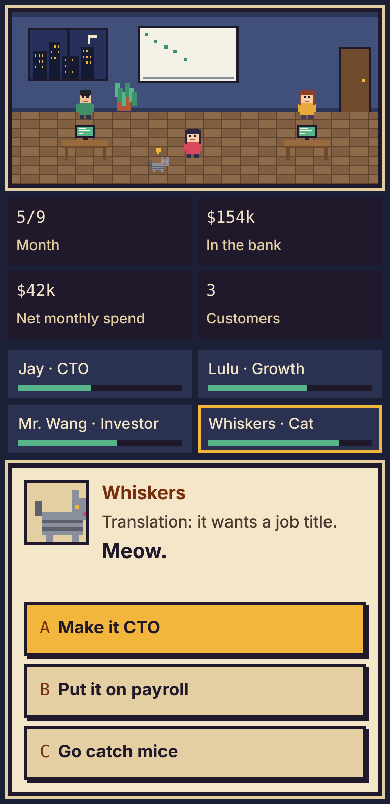
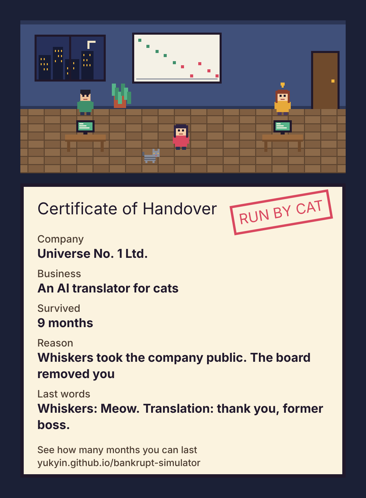

<h1 align="center">Bankrupt Simulator</h1>

A pixel-art startup game. Nine months, one choice a month, and your team remembers everything you say.

  

  
  &nbsp;
  

Works on phone and desktop, in English and Chinese.

